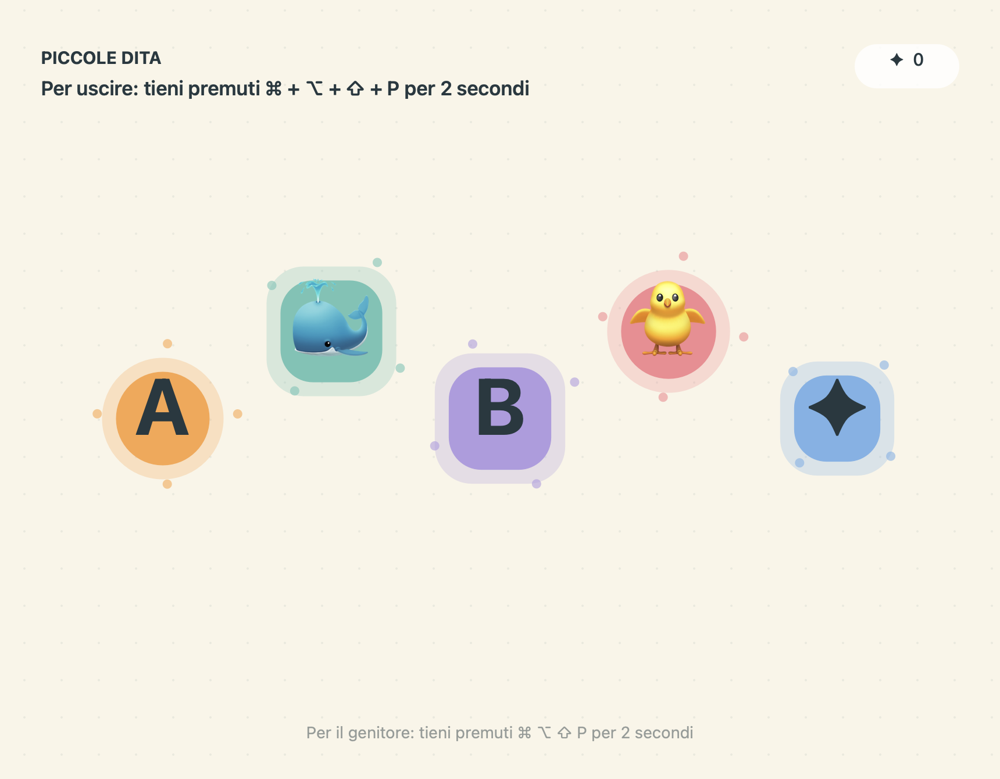

# Piccole Dita

Un piccolo parco giochi per la tastiera, come app nativa per macOS. Ogni pressione fa comparire lettere, animaletti o forme colorate, accompagnati da note musicali generate localmente.



## Scarica e avvia

Scarica **PiccoleDita-Mac-AppleSilicon.zip** dalle [release](https://github.com/francescorugg/piccole-dita/releases/latest), estrailo e apri **Piccole Dita.app**. Richiede un Mac con **Apple Silicon e macOS 14 o successivo**.

La release ha una firma locale ad hoc e **non è notarizzata da Apple**: macOS potrebbe impedirne l'apertura su altri computer. In alternativa puoi compilare i sorgenti sul tuo Mac.

Scegli suoni, movimento vivace o calmo e modalità lettere o animaletti. Poi premi **Inizia a giocare**, oppure Invio.

Esempio: premendo **A** compare una lettera colorata; nella modalità animaletti compare un piccolo animale. Anche clic, trascinamenti e rotella del mouse producono figure.

## Come uscire

Tieni premuti insieme **⌘ + ⌥ + ⇧ + P per 2 secondi**. Una barra indica l'avanzamento, poi ricompare la schermata iniziale. La combinazione è visibile in alto durante il gioco.

Per un'emergenza rimane disponibile **⌘ + ⌥ + Esc**, l'uscita forzata di macOS.

## Protezione dalle chiusure accidentali

Durante il gioco:

* La finestra copre il monitor scelto, senza pulsanti di chiusura.
* Dock e barra dei menu sono nascosti.
* Il cambio applicazione con Command + Tab è disabilitato tramite le opzioni di presentazione di AppKit.
* Esc, Command + Q, Command + W e gli altri normali eventi da tastiera vengono intercettati.
* Le ripetizioni automatiche dei tasti tenuti premuti vengono ignorate.

È una protezione dalle uscite accidentali, non un blocco completo del computer. Tasti hardware, Touch ID, scorciatoie globali, notifiche, gesti del trackpad e altri monitor possono restare accessibili. Per esempio, il tasto di accensione non viene bloccato. La modalità protetta si attiva solo dopo l'avvio del gioco.

## Privacy e suoni

Funziona offline, senza account, pubblicità, analytics o dipendenze esterne. Non salva i tasti premuti e non richiede permessi Accessibilità o Monitoraggio input. Le note vengono sintetizzate localmente, con un massimo di sei voci simultanee. Inizia con il volume del Mac basso.

## Compila dai sorgenti

Occorrono i Command Line Tools di Xcode, con `swiftc`, `sips`, `iconutil` e `codesign` disponibili.

```sh
./scripts/build.sh
open "dist/Piccole Dita.app"
```

Lo script crea l'app per Apple Silicon e lo ZIP nella cartella `dist/`. Usa una firma ad hoc locale.

## Verifica

La prima versione è stata compilata e verificata su macOS 26.7.1 con Apple Silicon. Sono stati verificati avvio, gestione di Esc e Command + Q, uscita del genitore e ripristino della finestra normale tramite interfaccia nativa. Controllati anche firma e metadati dell'app.

Il controllo automatico integrato attiva brevemente la protezione e poi la disattiva:

```sh
"dist/Piccole Dita.app/Contents/MacOS/PiccoleDita" --smoke-test
```

Non sono stati verificati tutti i gesti di sistema, le configurazioni con più monitor o le versioni precedenti di macOS. Non è una certificazione di modalità kiosk completa.

## Ispirazione

Ispirazione funzionale: [TinyFingers](https://tinyfingers.net/). Questa app usa codice e interfaccia propri e non è affiliata a TinyFingers. Le emoji sono renderizzate dai font di sistema di macOS.
